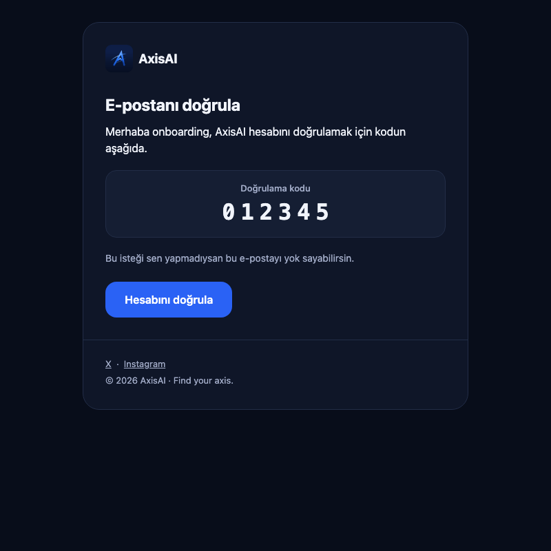
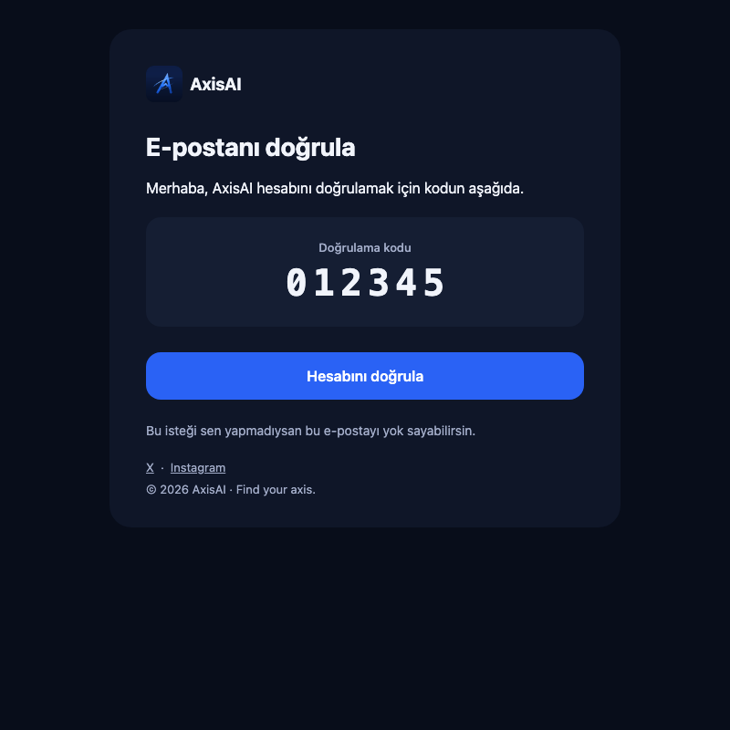
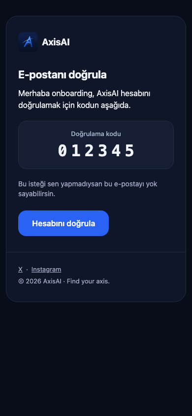
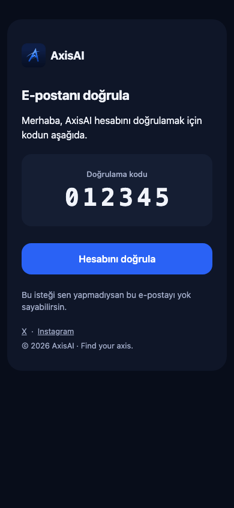
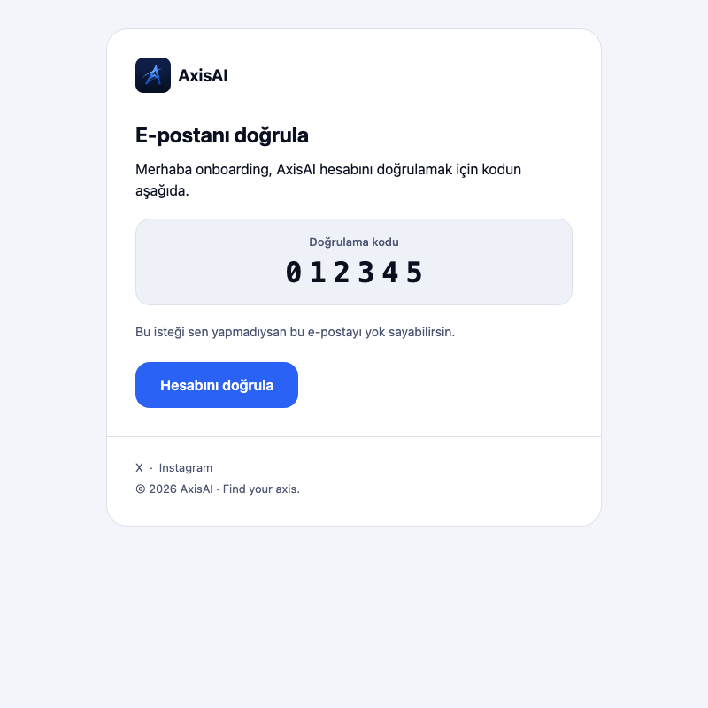
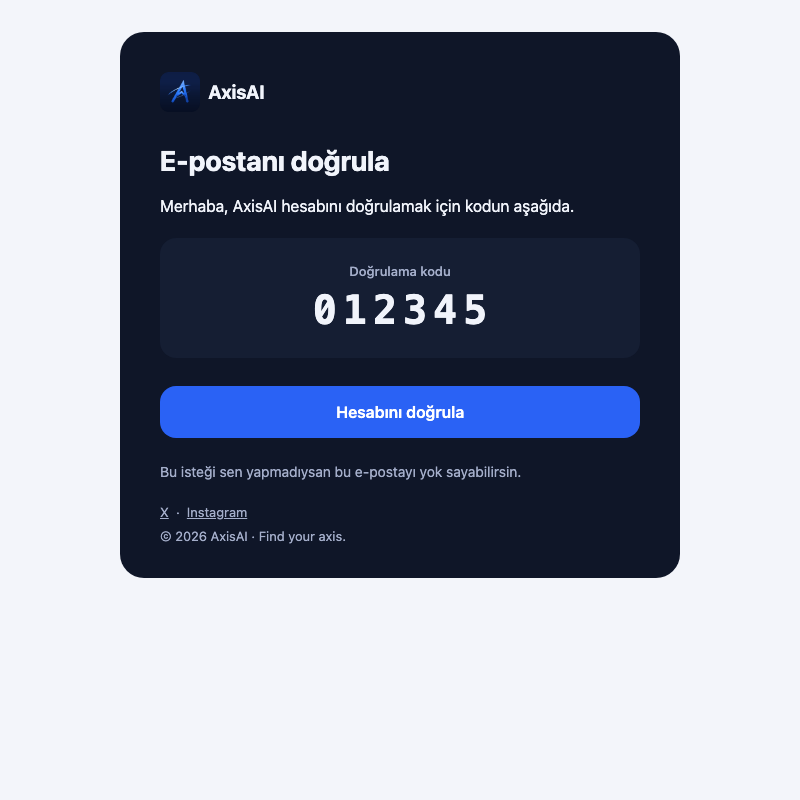
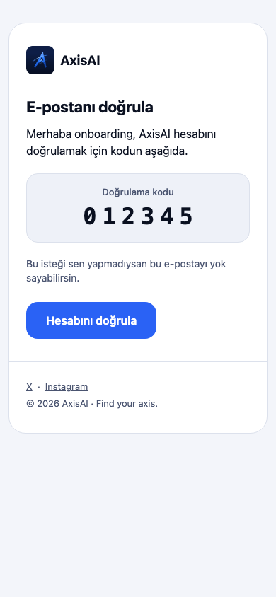
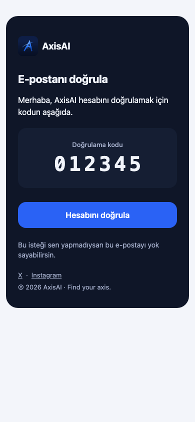

# Verification email — founder design review

Verification presentation only: official holo A + AxisAI wordmark, navy card,
larger selectable six-digit code, full-width blue CTA, and a compact footer.
The security note follows the CTA. The greeting is always **Merhaba,** (English:
**Hi,**) because Cognito can supply an internal username before onboarding.
No account attributes or authentication behavior change.

| Dark setting | Before | After |
| --- | --- | --- |
| Desktop, 800px |  |  |
| Mobile, 390px |  |  |

| Light setting | Before | After |
| --- | --- | --- |
| Desktop, 800px |  |  |
| Mobile, 390px |  |  |

[320px inline-only fallback, images blocked](previews/after-320-tr-light-inline-only.png)
· [English at 320px](previews/after-320-en-dark-full.png)
· [Before HTML](previews/before.html) · [After HTML](previews/after.html)
· [Plain-text fallback](previews/after.txt) · [Layout results](previews/checks.json)

All samples use synthetic name `onboarding` and synthetic code `012345`; no mail
was sent and no verification link was opened. Founder design approval is pending.
Do not merge or deploy to production before founder approval.

## Source and palette

- Backend baseline: `bfe132a0009f99b808d21fc9bc15e8cc365ee8b7` (`main`).
- Mobile token source: `axisai-mobile` at
  `c536fbfe3b122e9a08abb7207765f69b3d6efcf0`,
  `lib/app/theme/axisai_tokens.dart` (`AxisAiPalette`) and
  `docs/design/axis-signal/VISUAL_SYSTEM.md`.
- CTA: `#2A62F5`; card: `#0F1628`; code surface: `#151E33`;
  primary text: `#F1F4FB`; secondary text: `#A4AECA`.
  Canvas: `#F3F5FA` in light mode, `#080D1A` in supported dark mode.
- The existing public `https://www.axisaiapp.com/icon-holo.png` is unchanged.
  The local preview artwork was verified byte-identical to that public URL:
  SHA-256 `10a5de3d0f9b0e7eb3e1881dc65a8607afb2a17fcf61ce05f579485a4662ce59`.
  No new remote resources, fonts, or production dependencies.

## Integration and preserved behavior

Source path: Cognito `CustomEmailSender_SignUp` / `ResendCode` →
`infra/cognito-email-sender/src/handler.py` → `verification_code_email` →
`email_sender.send_html_email` → Resend. The same verification template also
serves `VerifyUserAttribute`. The canonical template is
`app/services/email_templates.py`; its Lambda copy remains byte-identical.
This traces the checked-in production integration; no live AWS configuration
was read or changed.

The subject, Turkish/English copy, Cognito code, `/verify` destination,
language selection, sender, recipient, encryption, expiration, and error
handling are preserved. Plain text changes only its greeting. The configured
HTML CTA URL is escaped without changing the destination. Reset, welcome, and
password-changed output is byte-identical to baseline in both languages.

## Validation and client limits

- 223 focused template, language, sender, sync, and Lambda-check tests pass.
- 102 existing authentication, password-reset, and Cognito regression tests pass.
- 40 browser layout checks pass: TR/EN × light/dark ×
  320/375/390/430/800px × normal/inline-only with images blocked.
  Checks cover horizontal overflow, all six digits including a leading zero,
  code contrast colors, CTA destination and minimum 48px height, and absence of
  the internal name. Six rendered comparisons prove unrelated templates unchanged.
- Retains presentation tables, inline colors/spacing, `bgcolor` fallbacks,
  Outlook fixed-width wrapper/font/padding fallbacks, and Apple data-detector
  overrides. Responsive rules use the existing width media query, consistent
  with [Gmail's CSS guidance](https://developers.google.com/workspace/gmail/design/css).
- Previews use Chromium, **not native Gmail, Apple Mail, or Outlook**. Client
  forced color inversion and Outlook's Word engine are not simulated or
  certified. The navy card is readable without head styles; supporting clients
  additionally adapt the surrounding canvas. The image-blocked view retains
  the AxisAI text wordmark and the usable code/CTA.

Reproduce with existing development dependencies and the unchanged brand image:

```sh
python scripts/render_verification_email_previews.py --brand-mark /path/to/icon-holo.png
```

The renderer blocks network requests and supplies the local mark. HTML previews
keep the original public image URL. It compares the fixed baseline to the current
template, writes PNG/HTML/text previews, and records its checks in `checks.json`.
